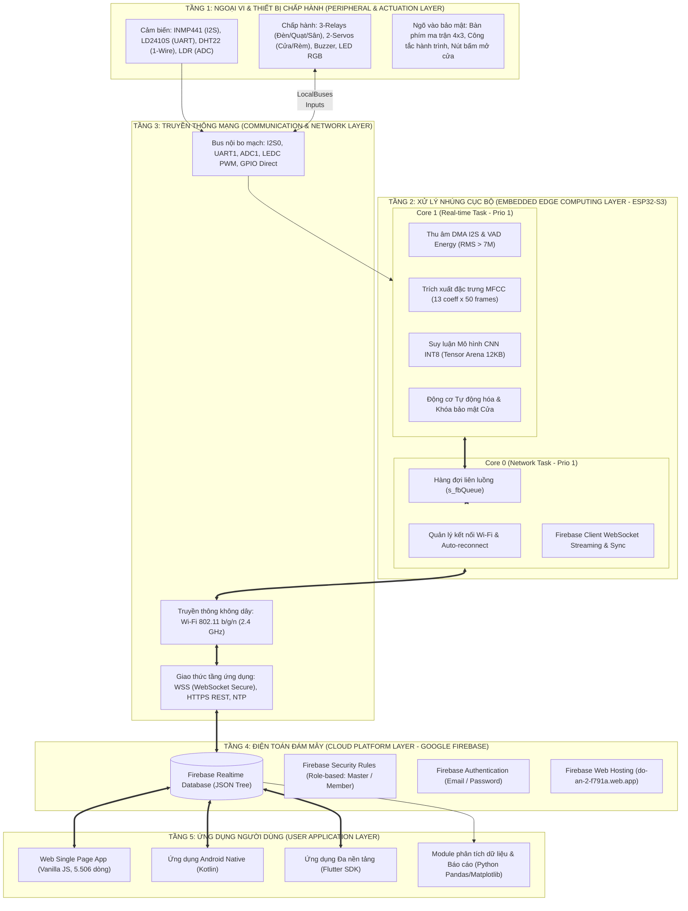

# CẤU TRÚC DỰ ÁN VÀ KIẾN TRÚC HỆ THỐNG

## 1. CÂY THƯ MỤC DỰ ÁN (PROJECT REPOSITORY TREE)

```text
d:\Firmware\Firmware-KWS-vietnamese-command\
├── .vscode/                               # Cấu hình IDE VS Code (c_cpp_properties.json, launch.json)
├── dataset/                               # Tập dữ liệu âm thanh giọng nói Tiếng Việt (19.905 files)
│   ├── training/                          # 13.822 mẫu âm thanh huấn luyện (10 nhãn)
│   ├── testing/                           # 3.227 mẫu âm thanh kiểm thử đánh giá độc lập
│   ├── data_train/                        # Tập dữ liệu legacy 7 nhãn (2.255 files)
│   ├── data_test/                         # Tập kiểm thử legacy 7 nhãn (301 files)
│   └── other/                             # Các kịch bản xử lý tiền xử lý dữ liệu âm thanh bằng Python
│       ├── audio_quality_checker.py       # Kiểm tra chất lượng mẫu WAV (độ dài, clipping, SNR)
│       ├── check_before_deploy.py         # Kiểm tra tính toàn vẹn mô hình INT8 trước deploy
│       ├── cut_background_noise.py        # Cắt lọc nhiễu môi trường tự động
│       ├── cut_noise.py                   # Tiền xử lý nhiễu
│       ├── test_preprocessing.py          # Kiểm thử pipeline trích xuất MFCC
│       └── to_1s.py                       # Chuẩn hóa độ dài các mẫu âm thanh về đúng 1.0 giây
├── docs/                                  # Hồ sơ tài liệu kỹ thuật & sơ đồ thiết kế
│   ├── 1-so-do-nguyen-ly.html / .pdf      # Sơ đồ nguyên lý điện tử chi tiết
│   ├── 2-luu-do-thuat-toan.html / .pdf    # Lưu đồ giải thuật hệ thống
│   ├── 3-chan-ket-noi-phan-cung.html/.pdf # Sơ đồ chân cắm và đấu nối ngoại vi
│   ├── 4-danh-sach-linh-kien.html / .pdf  # Bảng dự toán và định mức linh kiện (BOM)
│   ├── Tai-Lieu-Ky-Thuat-Tong-Hop.html    # Tài liệu kỹ thuật tổng hợp đồ án
│   └── SmartHome-KWS.apk                  # Bản cài đặt ứng dụng Android thành phẩm (24.4 MB)
├── include/                               # Tệp tiêu đề cấu hình firmware C/C++
│   ├── config.h                           # Định nghĩa 25 chân GPIO, hằng số ngưỡng, cấu hình phần cứng
│   └── ...                                # Header files của các module driver
├── lib/                                   # Thư viện mô hình học sâu nhúng (Edge Impulse TinyML)
│   └── KWS-Vietnamese-command_inferencing/# Gói thư viện C++ sinh tự động từ Edge Impulse
│       └── src/
│           ├── model-parameters/          # Tham số mạng nơ-ron, danh sách 10 nhãn, shape
│           ├── tflite-learners/           # Mã nguồn C++ mô hình lượng tử hóa INT8 (8 toán tử TFLite)
│           └── edge-impulse-sdk/          # TinyML runtime engine (DSP MFCC, Tensor Arena)
├── mobile_app/                            # Ứng dụng di động điều khiển
│   ├── android/                           # Cấu hình Gradle và mã native Android
│   ├── app/                               # Native Android Kotlin module
│   └── lib/                               # Mã nguồn Flutter cross-platform (main.dart, screens)
├── reports/                               # Báo cáo thực nghiệm & đồ thị phân tích
│   ├── analysis_report_chart.png          # Đồ thị phân tích 4 thành phần độ phân giải cao
│   └── BAO_CAO_PHAN_TICH_DU_LIEU.md       # Báo cáo phân tích 748 log lệnh giọng nói thực tế
├── src/                                   # Mã nguồn firmware chính của ESP32-S3
│   ├── main.cpp                           # Entry point: Khởi tạo, vòng lặp FreeRTOS, pipeline AI & Sensors
│   ├── firebase_handle.cpp                # Quản lý luồng mạng Core 0, stream WebSocket Firebase, đồng bộ
│   ├── automation_engine.cpp              # Động cơ tự động hóa ngữ cảnh & giải quyết xung đột
│   ├── door_controller.cpp                # Điều khiển cửa, băm Salted SHA-256, khóa cứng 120s
│   └── audio_provider.cpp                 # Driver thu âm I2S DMA từ micro INMP441
├── web/                                   # Ứng dụng Web Single Page App (SPA) điều khiển
│   └── index.html                         # Mã nguồn giao diện hoàn chỉnh (5.506 dòng JS/HTML/CSS)
├── analyze_logs.py                        # Script phân tích log đám mây & sinh biểu đồ tự động
├── database.rules.json                    # Cấu hình phân quyền bảo mật Firebase Realtime Database
├── firebase.json                          # Cấu hình triển khai Firebase Hosting & Database
├── partitions_custom.csv                  # Bảng phân vùng bộ nhớ Flash 16MB của ESP32-S3
└── platformio.ini                         # Cấu hình biên dịch PlatformIO (board, flags, dependencies)
```

---

## 2. KIẾN TRÚC HỆ THỐNG 5 TẦNG (5-LAYER SYSTEM ARCHITECTURE)

Hệ thống được thiết kế theo kiến trúc phân tầng chuẩn của hệ thống nhúng thông minh kết hợp IoT:



---

## 3. PHÂN TÍCH CÁC GIAO THỨC TRUYỀN THÔNG TRONG HỆ THỐNG

| Giao thức | Vị trí kết nối phần cứng | Tốc độ / Tần số | Vai trò và Đặc tính kỹ thuật | Nguồn trích dẫn code |
|:---|:---|:---:|:---|:---|
| **I2S (Inter-IC Sound)** | ESP32-S3 (GPIO 4, 5, 6) <-> Micro INMP441 | 16 kHz, 16-bit Mono (SCK ~512 kHz) | Thu nhận tín hiệu âm thanh kỹ thuật số trực tiếp qua DMA, không bị suy hao chất lượng như ADC analog. | `include/config.h:17-19`, `src/audio_provider.cpp` |
| **UART TTL** | ESP32-S3 (GPIO 10, 11) <-> Radar LD2410S | 115200 bps, 8N1 | Giao tiếp với cảm biến vi sóng 24GHz, nhận frame dữ liệu hiện diện người và khoảng cách mục tiêu. | `include/config.h:55-58` |
| **1-Wire (Bit-banging)** | ESP32-S3 (GPIO 16) <-> DHT22 | Tần số đọc 0.5 Hz (chu kỳ 2s) | Đọc dữ liệu nhiệt độ và độ ẩm số. Yêu cầu trở kéo lên (pullup) 10k lên 3.3V. | `include/config.h:51` |
| **ADC 12-bit** | ESP32-S3 (GPIO 1 / ADC1_CH0) <-> Quang trở LDR | Lấy mẫu mỗi 500ms | Chuyển đổi điện áp phân áp quang trở thành giá trị số nguyên 0 - 4095 biểu thị cường độ sáng. | `include/config.h:62` |
| **LEDC PWM** | ESP32-S3 (GPIO 9, 39, 17, 18, 8, 48) | 50 Hz (Servo), 5 kHz (LED RGB) | Điều khiển góc quay Servo (độ rộng xung 1000 - 2000µs), điều chế độ sáng LED RGB (8-bit) và tạo xung Buzzer. | `include/config.h:23-25, 35-36` |
| **Wi-Fi 802.11 b/g/n** | ESP32-S3 On-board RF (2.4 GHz) | Lên đến 72.2 Mbps | Kết nối vào mạng Access Point cục bộ của gia đình để truy cập Internet. | `src/firebase_handle.cpp` |
| **WebSocket Stream (WSS)** | ESP32-S3 <-> Firebase Realtime Database | Real-time push, TLS 1.2 | Lắng nghe tức thời mọi thay đổi tại node `/commands` từ Cloud mà không cần thăm dò (polling). | `src/firebase_handle.cpp` |
| **HTTPS REST (JSON)** | ESP32-S3 <-> Firebase RTDB | Theo sự kiện (Event-driven) | Đẩy telemetry cảm biến, log giọng nói và trạng thái phần cứng lên Cloud khi có biến động. | `src/firebase_handle.cpp` |
