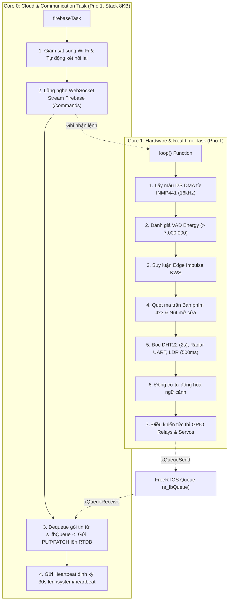

# THIẾT KẾ PHẦN CỨNG, BẢNG GÁN CHÂN GPIO VÀ KIẾN TRÚC FIRMWARE

## 1. THÔNG SỐ VI ĐIỀU KHIỂN ESP32-S3-DEVKITC-1 N16R8

Hệ thống sử dụng module vi điều khiển cao cấp **ESP32-S3-WROOM-1-N16R8**:
- **CPU**: Dual-Core 32-bit Xtensa LX7 hoạt động ở xung nhịp tối đa 240 MHz (tích hợp tập lệnh mở rộng Vector Instructions hỗ trợ tăng tốc ma trận cho mạng nơ-ron).
- **Bộ nhớ Flash**: 16 MB SPI Flash cấu hình chế độ Quad/Octal SPI (lưu trữ Firmware OTA và dữ liệu phân vùng).
- **Bộ nhớ PSRAM**: 8 MB Octal SPI (OPI) PSRAM chạy ở chế độ xung nhịp cao (High-speed bus), mở rộng không gian heap để lưu trữ các buffer âm thanh lớn và bảng tham số mô hình.
- **SRAM nội**: 512 KB SRAM + 16 KB RTC SRAM.
- **Kết nối không dây**: Wi-Fi 802.11 b/g/n (2.4 GHz) và Bluetooth 5.0 (LE).
- **Bảng phân vùng Flash (`partitions_custom.csv`)**:
  - `nvs`: 0x9000 (20 KB) - Lưu cấu hình Wi-Fi, mã PIN băm Salted SHA-256.
  - `otadata`: 0xe000 (8 KB) - Dữ liệu quản lý nạp firmware OTA.
  - `app0`: 0x10000 (7 MB) - Phân vùng chứa mã Firmware ứng dụng chính.
  - `app1`: 0x710000 (7 MB) - Phân vùng dự phòng nạp Firmware OTA.
  - `spiffs`: 0xe10000 (~1.875 MB) - Bộ nhớ tệp lưu trữ Web tĩnh cục bộ hoặc cấu hình.
  - `coredump`: 0xff0000 (64 KB) - Lưu crash dump khi gặp lỗi panic hệ thống.

---

## 2. BẢNG GÁN CHÂN NGOẠI VI MASTER (MASTER GPIO PINOUT TABLE)

Toàn bộ 25 chân GPIO được quy hoạch đồng bộ, không xảy ra xung đột tài nguyên phần cứng:

| GPIO | Tên định nghĩa trong code | Thiết bị ngoại vi kết nối | Loại tín hiệu | Mức điện áp / Cấu hình | Chức năng chi tiết trong hệ thống | Nguồn trích dẫn mã nguồn |
|:---:|:---|:---|:---:|:---:|:---|:---|
| **GPIO 1** | `LDR_PIN` | Cảm biến ánh sáng LDR | Analog In | 0 - 3.3V (ADC1_CH0) | Đọc điện áp phân áp quang trở để đo cường độ sáng | `include/config.h:62` |
| **GPIO 2** | `KEYPAD_C3` | Bàn phím ma trận 4x3 (Cột 3) | Digital In | 3.3V (INPUT_PULLUP) | Quét phím bấm các ký tự cột 3 (phím 3, 6, 9, #) | `include/config.h:47` |
| **GPIO 3** | `LIMIT_SW_CLOSE` | Công tắc hành trình Đóng | Digital In | 3.3V (INPUT_PULLUP) | Phát hiện cửa đã đóng hết vị trí giới hạn an toàn | `include/config.h:67` |
| **GPIO 4** | `I2S_SD_PIN` | Micro INMP441 Serial Data | Digital In | 3.3V Logic | Ngõ vào dữ liệu âm thanh số I2S0 DMA | `include/config.h:19` |
| **GPIO 5** | `I2S_WS_PIN` | Micro INMP441 Word Select | Digital Out | 3.3V Logic | Xung đồng bộ từ âm thanh (LRCK / WS @ 16 kHz) | `include/config.h:18` |
| **GPIO 6** | `I2S_SCK_PIN` | Micro INMP441 Bit Clock | Digital Out | 3.3V Logic | Xung xung nhịp bit âm thanh (BCLK / SCK) | `include/config.h:17` |
| **GPIO 7** | `KEYPAD_C1` | Bàn phím ma trận 4x3 (Cột 1) | Digital In | 3.3V (INPUT_PULLUP) | Quét phím bấm các ký tự cột 1 (phím 1, 4, 7, *) | `include/config.h:45` |
| **GPIO 8** | `LED_PIN_B` | LED RGB (Kênh Blue) | PWM Out | 3.3V (LEDC Ch2, 5kHz) | Chỉ thị trạng thái: Xanh dương khi đang lắng nghe | `include/config.h:25` |
| **GPIO 9** | `SERVO_CURTAIN_PIN`| Động cơ Servo Rèm cửa | PWM Out | 5V Tín hiệu (LEDC Ch7) | Điều khiển góc quay đóng/mở rèm (50Hz PWM) | `include/config.h:36` |
| **GPIO 10**| `RADAR_RX_PIN` | Radar LD2410S TX | Digital In | 3.3V (UART1 RX) | Tiếp nhận gói tin hiện diện từ cảm biến vi sóng | `include/config.h:55` |
| **GPIO 11**| `RADAR_TX_PIN` | Radar LD2410S RX | Digital Out | 3.3V (UART1 TX) | Truyền lệnh cấu hình độ nhạy sang cảm biến radar | `include/config.h:56` |
| **GPIO 12**| `KEYPAD_C2` | Bàn phím ma trận 4x3 (Cột 2) | Digital In | 3.3V (INPUT_PULLUP) | Quét phím bấm các ký tự cột 2 (phím 2, 5, 8, 0) | `include/config.h:46` |
| **GPIO 13**| `KEYPAD_R1` | Bàn phím ma trận 4x3 (Hàng 1) | Digital Out | 3.3V Logic | Quét mức tích cực hàng 1 (phím 1, 2, 3) | `include/config.h:40` |
| **GPIO 14**| `KEYPAD_R2` | Bàn phím ma trận 4x3 (Hàng 2) | Digital Out | 3.3V Logic | Quét mức tích cực hàng 2 (phím 4, 5, 6) | `include/config.h:41` |
| **GPIO 15**| `KEYPAD_R3` | Bàn phím ma trận 4x3 (Hàng 3) | Digital Out | 3.3V Logic | Quét mức tích cực hàng 3 (phím 7, 8, 9) | `include/config.h:42` |
| **GPIO 16**| `DHTPIN` | Cảm biến DHT22 (Nhiệt/Ẩm) | 1-Wire IO | 3.3V (Pullup 10k) | Đọc dữ liệu nhiệt độ và độ ẩm số môi trường | `include/config.h:51` |
| **GPIO 17**| `LED_PIN_R` | LED RGB (Kênh Red) | PWM Out | 3.3V (LEDC Ch0, 5kHz) | Chỉ thị trạng thái: Đỏ khi hệ thống bận hoặc báo động | `include/config.h:23` |
| **GPIO 18**| `LED_PIN_G` | LED RGB (Kênh Green) | PWM Out | 3.3V (LEDC Ch1, 5kHz) | Chỉ thị trạng thái: Xanh lá khi sẵn sàng / mở cửa | `include/config.h:24` |
| **GPIO 21**| `KEYPAD_R4` | Bàn phím ma trận 4x3 (Hàng 4) | Digital Out | 3.3V Logic | Quét mức tích cực hàng 4 (phím *, 0, #) | `include/config.h:43` |
| **GPIO 38**| `LIMIT_SW_OPEN` | Công tắc hành trình Mở | Digital In | 3.3V (INPUT_PULLUP) | Phát hiện cửa đã mở hết vị trí giới hạn | `include/config.h:66` |
| **GPIO 39**| `SERVO_DOOR_PIN` | Động cơ Servo Cửa chính | PWM Out | 5V Tín hiệu (LEDC Ch6) | Điều khiển cơ cấu trượt chốt mở/đóng cửa | `include/config.h:35` |
| **GPIO 40**| `RELAY_YARD` | Rơ-le 3 (Đèn Sân Vườn) | Digital Out | Active LOW (Opto 5V) | Đóng/cắt nguồn điện đèn sân ngoài trời | `include/config.h:31` |
| **GPIO 41**| `RELAY_LIGHT` | Rơ-le 1 (Đèn Sinh Hoạt) | Digital Out | Active LOW (Opto 5V) | Đóng/cắt nguồn điện đèn chiếu sáng sinh hoạt | `include/config.h:29` |
| **GPIO 42**| `RELAY_FAN` | Rơ-le 2 (Quạt Làm Mát) | Digital Out | Active LOW (Opto 5V) | Đóng/cắt nguồn điện động cơ quạt làm mát | `include/config.h:30` |
| **GPIO 47**| `DOOR_BUTTON_PIN`| Nút bấm cơ Mở cửa | Digital In | 3.3V (Trở kéo ngoài 10k)| Nút bấm cơ mở cửa khẩn cấp từ bên trong nhà | `include/config.h:68` |
| **GPIO 48**| `BUZZER_PIN` | Còi chip cảnh báo Buzzer | PWM / Out | 5V Logic | Phát âm bíp thông báo và còi báo động khi nhập sai | `include/config.h:71` |

---

## 3. THIẾT KẾ NGUỒN VÀ GIẢI PHÁP CHỐNG SỤT ÁP (BROWNOUT PREVENTION)

Trong hệ thống Smart Home tích hợp tải cảm ứng và cơ điện tử (cuộn hút rơ-le, động cơ Servo MG996R, sóng cao tần Wi-Fi), việc thiết kế nguồn điện là yếu tố sống còn quyết định độ ổn định:

1. **Phân tích dòng đỉnh tiêu thụ (Peak Current Consumption)**:
   - ESP32-S3 phát Wi-Fi TX (802.11b @ 20dBm): dòng tức thời lên tới **350 - 450 mA**.
   - 3 Rơ-le đóng đồng thời: mỗi cuộn hút cuộn dây tiêu thụ ~70mA -> Tổng **210 mA**.
   - 2 Động cơ Servo khi khởi động (Stall Current): Servo MG996R có dòng đề-pa đạt **1.2A - 1.5A**; Servo SG90 tiêu thụ **400 - 500 mA**.
   - Các cảm biến (Radar mmWave, DHT22, LDR, Micro): ~**80 mA**.
   - **Tổng dòng đỉnh tức thời có thể đạt**: $pprox 2.3A - 2.5A$.
2. **Hiện tượng Brownout Reset**:
   - Nếu dùng nguồn Adapter 5V/1A thông thường hoặc cấp nguồn qua cổng USB máy tính, khi Servo quay hoặc Wi-Fi phát xung TX, điện áp trên đường 5V sẽ sụt xuống dưới 4.2V, kéo theo điện áp ngõ ra của IC hạ áp 3.3V (AMS1117) sụt xuống dưới ngưỡng phát hiện Brownout của ESP32-S3 (thường là 2.8V), khiến vi điều khiển bị reset liên tục.
3. **Giải pháp kỹ thuật đã triển khai**:
   - Sử dụng bộ nguồn chuyển mạch xung (Switching Adapter) độc lập **5V / 3A DC** chất lượng cao.
   - Bố trí tụ hóa dung lượng lớn **1000 µF / 16V** mắc song song với tụ gốm **100 nF** ngay tại thanh cấp nguồn 5V chung của module Servo và Rơ-le để hấp thụ xung sụt áp tức thời.
   - Đi dây nguồn riêng biệt: Đường nguồn 5V cấp cho động cơ Servo được tách riêng một nhánh từ ngõ ra nguồn chính, nối chung mass (Common Ground) với vi điều khiển.
   - Chân `GPIO 47` (Nút bấm mở cửa) được trang bị trở kéo lên vật lý **10 kΩ ra 3.3V** riêng biệt để chống nhiễu cảm ứng điện từ từ chân `GPIO 48` (Buzzer) liền kề.

---

## 4. KIẾN TRÚC ĐA NHÂN FREERTOS (DUAL-CORE ARCHITECTURE)

ESP32-S3 chạy hệ điều hành thời gian thực FreeRTOS, được cấu hình phân tách nhiệm vụ rạch ròi giữa 2 lõi CPU:

- **Core 1 (Thời gian thực - Real-time Core)**: Chịu trách nhiệm 100% thời gian lấy mẫu âm thanh không trễ, tính năng lượng VAD, chạy suy luận TinyML, quét phím bảo mật và kích hoạt Rơ-le tức thì.
- **Core 0 (Truyền thông mạng - Network Core)**: Chạy tác vụ nền `firebaseTask`. Mọi hoạt động truyền gói tin TCP/IP, bắt tay mã hóa TLS/SSL, đọc stream WebSocket diễn ra độc lập.
- **Cơ chế đồng bộ liên luồng**: Sử dụng hàng đợi `s_fbQueue` (`QueueHandle_t`). Khi Core 1 nhận diện được giọng nói hoặc thay đổi trạng thái thiết bị, nó chỉ mất < 2µs để đẩy con trỏ sự kiện vào `s_fbQueue`, sau đó tiếp tục chu kỳ lấy mẫu âm thanh mà không bao giờ bị nghẽn (non-blocking) bởi độ trễ mạng Internet.
