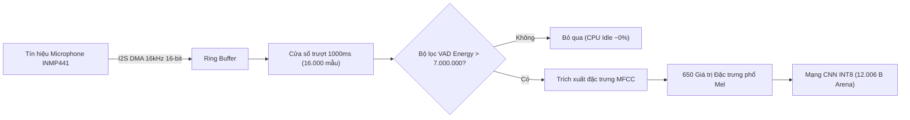

# MÔ HÌNH HỌC SÂU NHÚNG (TINYML) VÀ XỬ LÝ GIỌNG NÓI TIẾNG VIỆT CỤC BỘ

## 1. THÔNG TIN MÔ HÌNH VÀ DỰ ÁN EDGE IMPULSE
- **Nền tảng thiết kế & huấn luyện**: Edge Impulse Studio (Mã nguồn triển khai nhúng C++ EON Compiler).
- **Tên dự án**: `KWS-Vietnamese-Research`
- **Mã định danh dự án (Project ID)**: `1152015`
- **Phiên bản mô hình (Version)**: `4`
- **Chủ sở hữu dự án (Owner)**: `hi201205`
- **Vị trí mã nguồn trong repo**: `lib/KWS-Vietnamese-command_inferencing/`

---

## 2. TẬP DỮ LIỆU ÂM THANH (DATASET SPECIFICATIONS)
Hệ thống sử dụng tập dữ liệu âm thanh giọng nói Tiếng Việt được thu âm, chuẩn hóa và gán nhãn thực tế:
- **Tổng số mẫu âm thanh v4**: **17.049 mẫu** WAV (Tổng số tệp âm thanh trong kho lưu trữ `dataset/` đạt **19.905 tệp** bao gồm cả các tập thử nghiệm legacy).
- **Phân chia tập Train / Test**:
  - **Tập huấn luyện (Training Set)**: 13.822 mẫu (81.1%).
  - **Tập kiểm thử độc lập (Testing Set)**: 3.227 mẫu (18.9%).
- **Định dạng âm thanh chuẩn hóa**:
  - Tần số lấy mẫu: **16.000 Hz** (16 kHz).
  - Độ sâu bit: **16-bit Linear PCM**, đơn kênh (Mono).
  - Độ dài mẫu: Đúng **1.0 giây** (16.000 mẫu số).
  - Tổng thời lượng âm thanh huấn luyện & kiểm thử: $pprox$ **4.74 giờ**.

### Bảng phân bố 10 nhãn dữ liệu (10 Classes):
| STT | Nhãn (Label) | Ý nghĩa khẩu lệnh | Tập Train | Tập Test | Tổng mẫu | Tỷ lệ Train/Test |
|:---:|:---|:---|:---:|:---:|:---:|:---:|
| 1 | `bat_den` | Bật đèn sinh hoạt phòng chính | 1.198 | 280 | 1.478 | 81.1% / 18.9% |
| 2 | `dong_vao` | Đóng rèm cửa hoặc đóng cửa trượt | 1.139 | 266 | 1.405 | 81.1% / 18.9% |
| 3 | `lanh_qua` | Lạnh quá (kích hoạt tắt quạt tự động) | 1.230 | 287 | 1.517 | 81.1% / 18.9% |
| 4 | `mo_ra` | Mở rèm cửa hoặc mở cửa trượt | 1.160 | 271 | 1.431 | 81.1% / 18.9% |
| 5 | `nong_qua` | Nóng quá (kích hoạt bật quạt tự động) | 1.159 | 271 | 1.430 | 81.0% / 19.0% |
| 6 | `tam_biet` | Tạm biệt (kích hoạt kịch bản ra khỏi nhà) | 1.178 | 275 | 1.453 | 81.1% / 18.9% |
| 7 | `tat_den` | Tắt đèn sinh hoạt phòng chính | 1.197 | 279 | 1.476 | 81.1% / 18.9% |
| 8 | `unknown` | Âm thanh tạp âm môi trường & từ ngoài tập từ vựng | 3.195 | 746 | 3.941 | 81.1% / 18.9% |
| 9 | `vung_oi` | Từ khóa đánh thức hệ thống (Wake-word) | 1.173 | 274 | 1.447 | 81.1% / 18.9% |
| 10 | `xin_chao` | Lời chào mừng khi về đến nhà | 1.193 | 278 | 1.471 | 81.1% / 18.9% |
| **Tổng** | **10 Lớp** | **Toàn bộ hệ thống** | **13.822**| **3.227**| **17.049**| **81.1% / 18.9%** |

---

## 3. CHUỖI TIỀN XỬ LÝ TÍN HIỆU ÂM THANH (AUDIO PREPROCESSING PIPELINE)

### 3.1. Kỹ thuật Cửa sổ trượt (Sliding Window)
- Kích thước cửa sổ (Window Size): **1.000 ms** (16.000 mẫu âm thanh).
- Bước trượt cửa sổ (Window Hop/Stride): **200 ms** (3.200 mẫu âm thanh).
- Đặc tính: Cứ mỗi 200ms, hệ thống bổ sung 3.200 mẫu âm thanh mới nhất từ DMA buffer vào cuối cửa sổ và dịch chuyển 3.200 mẫu cũ nhất ra ngoài, đảm bảo không bỏ sót bất kỳ từ khẩu lệnh nào ngay cả khi người dùng bắt đầu nói giữa chu kỳ lấy mẫu.

### 3.2. Thuật toán phát hiện tiếng nói VAD (Voice Activity Detection)
- Nhằm giải quyết triệt để vấn đề vi điều khiển ESP32 bị quá nhiệt và nghẽn tài nguyên do chạy suy luận mạng nơ-ron liên tục, hệ thống đã cài đặt thuật toán lọc năng lượng âm thanh VAD:
  $$	ext{Energy} = \sum_{i=0}^{N-1} x[i]^2$$
- **Ngưỡng năng lượng VAD (`VAD_ENERGY_THRESH`)**: Được hiệu chỉnh ở mức **7.000.000** (khắc phục lỗi cũ đặt ở mức 3.000.000 khiến tạp âm văn phòng 3.5M - 4M kích hoạt suy luận liên tục).
- Khi môi trường yên tĩnh ($	ext{Energy} \le 7.000.000$), bộ suy luận TinyML hoàn toàn không chạy, mức chiếm dụng CPU của Core 1 gần như bằng 0%, vi điều khiển mát và tiết kiệm năng lượng tối đa.

---

## 4. BỘ TRÍCH XUẤT ĐẶC TRƯNG ÂM PHỔ (MFCC - MEL-FREQUENCY CEPSTRAL COEFFICIENTS)
Mô hình sử dụng các tham số chuẩn hóa của khối DSP MFCC:
- **Tần số lấy mẫu đầu vào**: 16.000 Hz.
- **Độ dài khung phân tích (Frame Length)**: **0.02 giây** (20 ms = 320 mẫu).
- **Bước nhảy khung (Frame Stride)**: **0.02 giây** (20 ms = 320 mẫu).
- **Số điểm biến đổi Fourier nhanh (FFT Length)**: **256 điểm**.
- **Số bộ lọc băng tần Mel (Mel Filterbanks)**: **32 bộ lọc**.
- **Hệ số Cepstral trích xuất (Number of Cepstral Coefficients)**: **13 hệ số**.
- **Tổng kích thước vector đặc trưng đầu ra**:
  $$	ext{Số khung} = rac{1.0	ext{s}}{0.02	ext{s}} = 50	ext{ khung}$$
  $$	ext{Tổng số đặc trưng} = 50 	imes 13 = \mathbf{650	ext{ giá trị thực}}$$

---

## 5. KIẾN TRÚC MẠNG NƠ-RON HỌC SÂU (INT8 QUANTIZED CNN)
Mô hình được tối ưu hóa qua trình biên dịch **EON Compiler** của Edge Impulse, chuyển đổi thành mã C++ tĩnh thuần túy không cần runtime interpreter cồng kềnh:
- **Định dạng lượng tử hóa**: **INT8** (Trọng số và kích hoạt dạng số nguyên có dấu 8-bit `int8_t`).
- **Tổng số toán tử (8 TFLite Operators)** trong `tflite-learners/default_model_compiled.cpp`:
  1. `OP_RESHAPE`: Tái định hình ma trận 650 đặc trưng thành tensor 2D phổ ảnh $[1, 50, 13, 1]$.
  2. `OP_CONV_2D`: Tầng tích chập 2 chiều đầu tiên (trích xuất đặc trưng không gian tần số thời gian).
  3. `OP_MAX_POOL_2D`: Tầng giảm chiều dữ liệu (Max Pooling 2D).
  4. `OP_CONV_2D`: Tầng tích chập 2 chiều thứ hai (trích xuất đặc trưng sâu).
  5. `OP_MAX_POOL_2D`: Tầng giảm chiều dữ liệu lần 2.
  6. `OP_RESHAPE`: Làm phẳng tensor (Flatten) thành vector 1 chiều.
  7. `OP_FULLY_CONNECTED`: Tầng kết nối đầy đủ (Dense Layer) ánh xạ đặc trưng về 10 nơ-ron ngõ ra.
  8. `OP_SOFTMAX`: Hàm kích hoạt xác suất chuẩn hóa tổng bằng 1.0 cho 10 lớp nhãn.
- **Bộ nhớ đệm Tensor Arena**: Chỉ chiếm đúng **12.006 bytes** ($pprox 11.72	ext{ KB}$ SRAM), cực kỳ tối ưu cho bộ nhớ của vi điều khiển nhúng.
- **Cờ cấp phát bộ nhớ tĩnh**: `-DEI_CLASSIFIER_ALLOCATION_STATIC` trong `platformio.ini`, ngăn chặn hoàn toàn hiện tượng phân mảnh bộ nhớ heap (Heap fragmentation) trong quá trình vận hành liên tục nhiều tháng.

---

## 6. SO SÁNH VỚI MÔ HÌNH TIỀN NHIỆM (LEGACY DS-CNN V2)
Trước khi nâng cấp lên phiên bản Edge Impulse 10 nhãn, dự án đã thử nghiệm mô hình mạng tích chập tách biệt chiều sâu (Depthwise Separable CNN - DS-CNN v2) với 7 lớp nhãn (`dataset/other/check_before_deploy.py`):
- 7 nhãn cũ: `bat_den`, `tat_den`, `bat_quat`, `tat_quat`, `bat_het`, `tat_het`, `noise`.
- Dung lượng model: 48.6 KB TFLite INT8.
- Ưu điểm của mô hình 10 nhãn hiện tại: Bổ sung khả năng nhận diện ngữ cảnh cảm xúc (`nong_qua`, `lanh_qua`), từ khóa chào đón (`xin_chao`), từ khóa rời nhà (`tam_biet`), từ khóa kích hoạt (`vung_oi`) và điều khiển cửa/rèm (`mo_ra`, `dong_vao`), mở rộng vượt bậc khả năng tự nhiên hóa giao tiếp người - máy.
