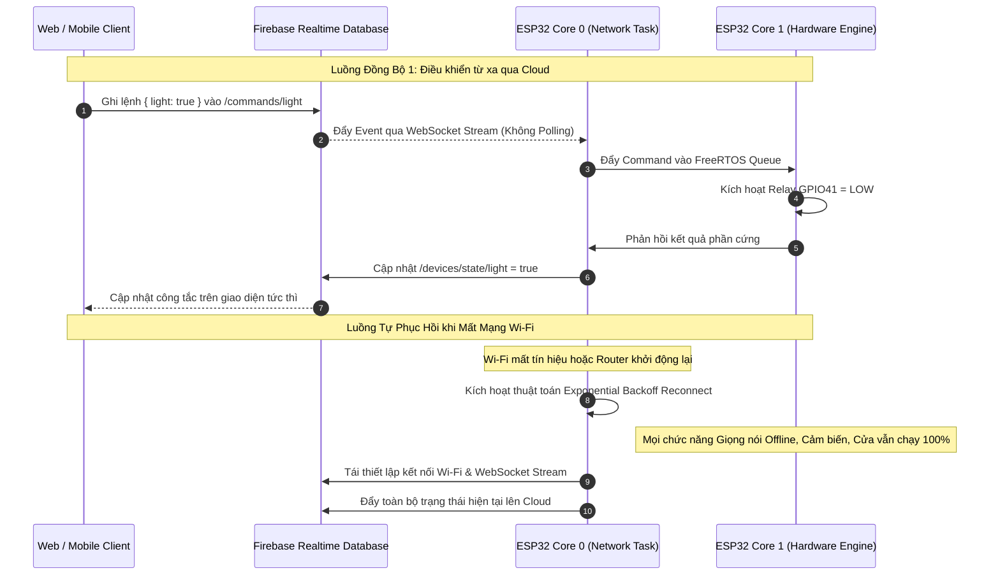

# ĐIỆN TOÁN ĐÁM MÂY, CƠ SỞ DỮ LIỆU VÀ BẢO MẬT MẠNG

## 1. THÔNG SỐ NỀN TẢNG CLOUD GOOGLE FIREBASE
- **Dịch vụ máy chủ**: Google Firebase Realtime Database (RTDB) & Firebase Web Hosting.
- **Định danh dự án (Project ID)**: `do-an-2-f791a`
- **Địa chỉ cơ sở dữ liệu (Database Host)**: `https://do-an-2-f791a-default-rtdb.asia-southeast1.firebasedatabase.app`
- **Địa chỉ Web Hosting chính thức**: `https://do-an-2-f791a.web.app`
- **Tài khoản quản trị tối cao (Master Owner)**: `xhai2005@gmail.com`
- **Mã nhận diện ngôi nhà (Paired Home ID)**: `HOME-2026-ESP32`

---

## 2. CẤU TRÚC LƯỢC ĐỒ DỮ LIỆU THỜI GIAN THỰC (RTDB SCHEMA)

Cơ sở dữ liệu được tổ chức theo mô hình cây JSON phi quan hệ (NoSQL Tree):

```text
root
├── system/                    # Giám sát trạng thái hoạt động của vi điều khiển ESP32-S3
│   ├── heartbeat: number      # Timestamp gửi nhịp tim sống gần nhất (chu kỳ 30s)
│   ├── ip: string             # Địa chỉ IP cục bộ của bo mạch trong mạng Wi-Fi
│   ├── uptime: number         # Số giây hoạt động liên tục từ lúc khởi động
│   ├── free_heap: number      # Dung lượng bộ nhớ RAM nội tuyến còn rảnh (bytes)
│   └── free_psram: number     # Dung lượng bộ nhớ ngoài PSRAM 8MB còn rảnh (bytes)
├── devices/state/             # Phản ánh trạng thái thực tế của phần cứng tại chỗ
│   ├── light: boolean         # Rơ-le đèn phòng sinh hoạt (GPIO41)
│   ├── fan: boolean           # Rơ-le quạt làm mát (GPIO42)
│   ├── yard: boolean          # Rơ-le đèn sân vườn (GPIO40)
│   ├── curtain: string        # Trạng thái rèm cửa ("open", "closed", "stopped")
│   ├── door: string           # Trạng thái cửa chính ("open", "closed", "stopped")
│   ├── keypad_locked: boolean # Cờ báo động khóa cứng bàn phím do nhập sai 4 lần
│   └── lock_remaining_s: num  # Số giây đếm ngược còn lại của thời gian khóa
├── commands/                  # Tiếp nhận lệnh điều khiển từ các ứng dụng Web/Mobile
│   ├── light: boolean         # Lệnh bật/tắt đèn
│   ├── fan: boolean           # Lệnh bật/tắt quạt
│   ├── yard: boolean          # Lệnh bật/tắt đèn sân
│   ├── curtain: string        # Lệnh điều khiển rèm ("open", "close", "stop")
│   ├── door: string           # Lệnh điều khiển cửa chính ("open", "close", "stop")
│   └── voice: string          # Mô phỏng lệnh giọng nói từ xa
├── sensors/latest/            # Số liệu đo đạc mới nhất từ các cảm biến ngoại vi
│   ├── temperature: number    # Nhiệt độ phòng (°C) từ cảm biến DHT22
│   ├── humidity: number       # Độ ẩm không khí (%RH) từ cảm biến DHT22
│   ├── presence: boolean      # Phát hiện có người hay không từ Radar LD2410S
│   ├── target_distance: number# Khoảng cách đến mục tiêu di chuyển/đứng yên (cm)
│   ├── light_level: number    # Cường độ sáng từ quang trở LDR (0 - 4095 ADC)
│   └── updated_at: number     # Thời điểm cập nhật dữ liệu cảm biến (Unix timestamp)
├── automation/rules/          # Danh sách cấu hình các quy tắc tự động hóa ngữ cảnh
├── door/passcodes/            # Danh sách mã PIN băm Salted SHA-256
├── users/$uid/                # Thông tin người dùng, quyền hạn (Master/Member), ghép nối nhà
├── invites/$code/             # Mã lời mời cấp quyền thành viên gia đình
└── logs/                      # Lịch sử sự kiện phục vụ phân tích dữ liệu lớn
    ├── voice/                 # 748 log lệnh giọng nói (thời gian, nhãn, confidence, độ trễ)
    └── sensors/               # Lịch sử nhiệt ẩm môi trường định kỳ
```

---

## 3. PHÂN TÍCH QUY TẮC BẢO MẬT DỮ LIỆU (SECURITY RULES AUDIT)
Tệp `database.rules.json` thiết lập chính sách kiểm soát truy cập dựa trên vai trò (Role-Based Access Control - RBAC) nghiêm ngặt:

1. **Phân quyền Master tối cao (`xhai2005@gmail.com`)**:
   - Có toàn quyền đọc (`.read`) và ghi (`.write`) trên toàn bộ các nhánh dữ liệu của ngôi nhà, bao gồm quản trị người dùng, cấu hình quy tắc tự động hóa và cấp quyền thành viên.
2. **Cơ chế ghép nối thành viên qua Mã Lời Mời (`invites`)**:
   - Thành viên mới sau khi đăng ký tài khoản bắt buộc phải nhập mã mời hợp lệ do Chủ nhà cấp. Khi mã được sử dụng, hệ thống chuyển trạng thái `status: 'used'`, liên kết `pairedHome: 'HOME-2026-ESP32'` và gán UID của thành viên đó.
3. **Phân quyền chi tiết trên từng thiết bị (Granular Permissions)**:
   - Các thành viên gia đình chỉ được ghi vào các lệnh điều khiển (`commands/light`, `commands/fan`, v.v.) nếu trường quyền tương ứng trong hồ sơ cá nhân của họ được Master kích hoạt:
     `root.child('users').child(auth.uid).child('permissions').child('light').val() !== false`
4. **Bảo vệ phần cứng (`devices/state`)**:
   - Cấm hoàn toàn mọi client ghi trực tiếp vào `devices/state` (`".write": "false"` ngoại trừ cờ mở khóa khẩn cấp). Chỉ có ESP32-S3 sử dụng Database Secret/Token mới có quyền cập nhật trạng thái thực của phần cứng, chống lại việc làm giả trạng thái thiết bị từ các cuộc tấn công mạng.

---

## 4. CƠ CHẾ ĐỒNG BỘ HAI CHIỀU VÀ KHẢ NĂNG TỰ PHỤC HỒI (SELF-HEALING NETWORK)



- **Lắng nghe sự kiện (Event-driven Streaming)**: Sử dụng phương thức stream của Firebase ESP Client. Vi điều khiển không cần gửi yêu cầu HTTP GET định kỳ, giúp giảm 98% băng thông mạng và độ trễ phản hồi từ Cloud xuống chỉ còn **150 - 350 ms**.
- **Hoạt động độc lập (Edge Autonomy)**: Khi ngắt hoàn toàn kết nối Wi-Fi, hệ thống nhận diện giọng nói Tiếng Việt, động cơ tự động hóa cảm biến và hệ thống kiểm soát cửa vẫn vận hành trơn tru tại biên. Sau khi kết nối mạng được khôi phục, Core 0 tự động bắt tay lại với Firebase và đồng bộ toàn bộ telemetry mới nhất.
