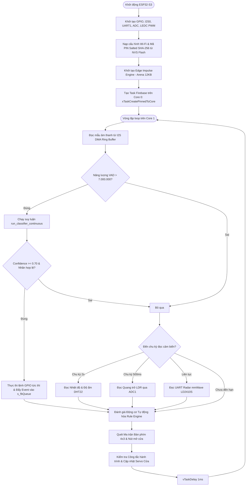
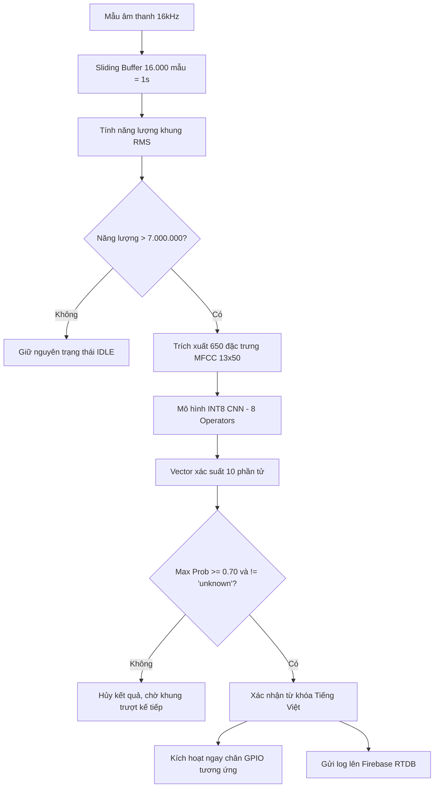
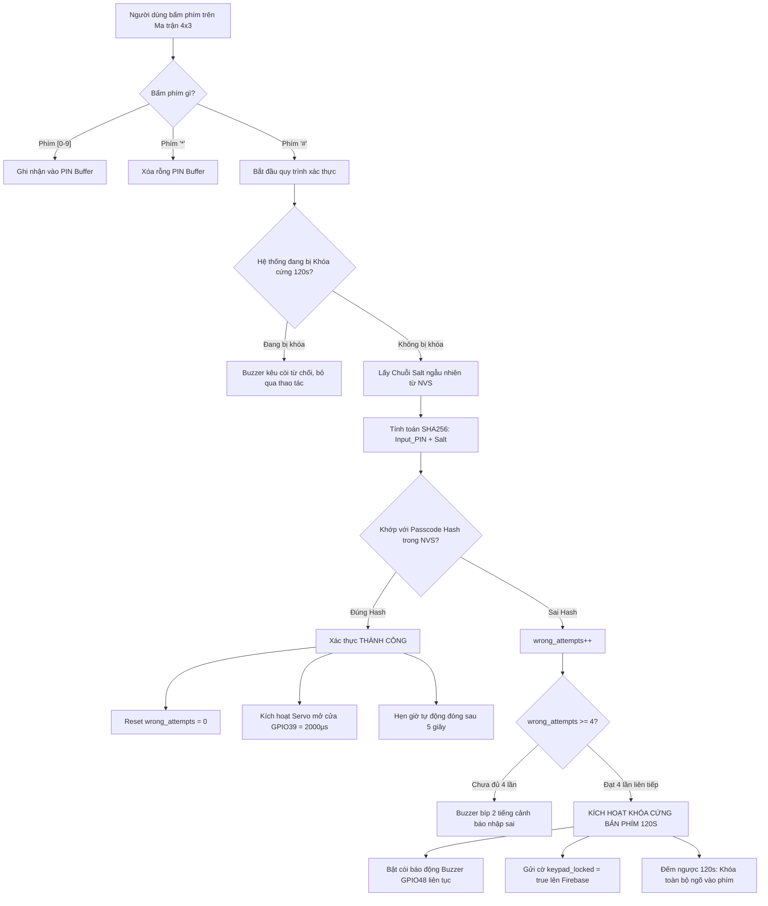
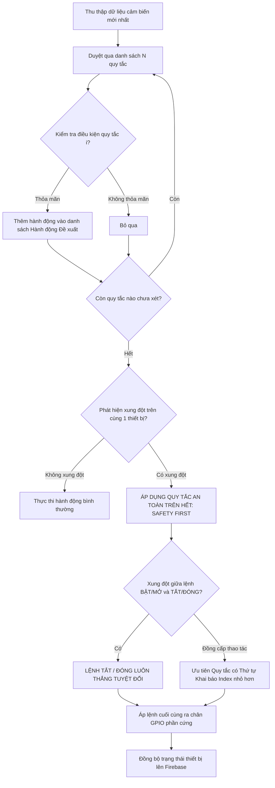

# GIẢI THUẬT, MÃ GIẢ VÀ LƯU ĐỒ THUẬT TOÁN HỆ THỐNG

## 1. THUẬT TOÁN VÒNG LẶP CHÍNH (MAIN EXECUTION LOOP & DUAL-CORE SCHEDULING)



### Mã giả Vòng lặp chính (`src/main.cpp`):
```text
ALGORITHM MainLoop_Core1:
BEGIN
    // 1. Xử lý âm thanh & suy luận TinyML
    audio_samples = I2S_Read_DMA();
    current_energy = Calculate_RMS_Energy(audio_samples);
    
    IF current_energy > 7000000 THEN
        result = run_classifier_continuous(audio_buffer);
        IF result.max_confidence >= 0.70 AND result.label != "unknown" THEN
            Execute_Local_Action(result.label);
            Queue_Send(s_fbQueue, EVENT_VOICE, result.label, result.max_confidence);
        END IF
    END IF
    
    // 2. Thu thập dữ liệu cảm biến định kỳ
    IF CurrentTime - LastSensorRead >= 2000ms THEN
        temp = DHT22_Read_Temperature();
        humid = DHT22_Read_Humidity();
        ldr = ADC_Read_LDR();
        presence = Radar_Read_Presence();
        Evaluate_Automation_Rules(temp, humid, ldr, presence);
        Queue_Send(s_fbQueue, EVENT_TELEMETRY, temp, humid, ldr, presence);
        LastSensorRead = CurrentTime;
    END IF
    
    // 3. Quét bảo mật cửa
    key = Keypad_Scan_Matrix();
    IF key IS_VALID THEN
        Process_Keypad_Input(key);
    END IF
    Check_Door_Limits_And_Timeout();
    
    Yield_CPU(1ms);
END
```

---

## 2. THUẬT TOÁN NHẬN DẠNG GIỌNG NÓI KWS LIÊN TỤC VỚI VAD



---

## 3. THUẬT TOÁN BẢO MẬT CỬA: SALTED SHA-256 VÀ CHỐNG BRUTE-FORCE



### Mã giả Quy trình Băm Salted SHA-256 (`src/door_controller.cpp`):
```text
FUNCTION Verify_Passcode(input_pin):
    salt = Read_From_NVS("pin_salt");
    computed_hash = SHA256(input_pin + salt);
    stored_hash = Read_From_NVS("pin_hash");
    
    IF computed_hash == stored_hash THEN
        wrong_count = 0;
        Open_Door_Servo();
        RETURN SUCCESS;
    ELSE
        wrong_count = wrong_count + 1;
        IF wrong_count >= 4 THEN
            lockout_until = CurrentTime + 120_SECONDS;
            Trigger_Buzzer_Alarm();
            Sync_Cloud_Lockout(TRUE);
        END IF
        RETURN FAILED;
    END IF
END FUNCTION
```

---

## 4. THUẬT TOÁN ĐỘNG CƠ TỰ ĐỘNG HÓA VÀ GIẢI QUYẾT XUNG ĐỘT (CONFLICT RESOLUTION)

Khi người dùng cấu hình đồng thời nhiều quy tắc tự động hóa ngữ cảnh, có thể xảy ra tình trạng quy tắc A yêu cầu BẬT quạt (do nhiệt độ > 30°C) nhưng quy tắc B lại yêu cầu TẮT quạt (do khung giờ đêm). Động cơ đã cài đặt thuật toán giải quyết xung đột tất định (Deterministic Conflict Resolution):



- **Nguyên lý An toàn Tuyệt đối (Safety First)**: Lệnh **TẮT** thiết bị điện hoặc **ĐÓNG** rèm/cửa luôn được trao quyền ưu tiên tối cao nhất so với lệnh BẬT/MỞ nhằm triệt tiêu hoàn toàn rủi ro cháy nổ do quá nhiệt hoặc rò rỉ an ninh khi người dùng vắng nhà.
